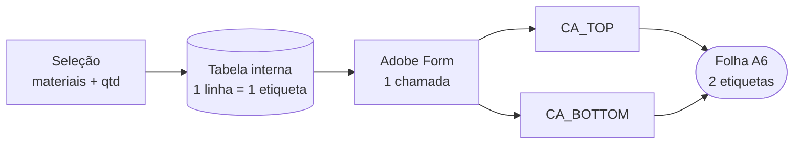
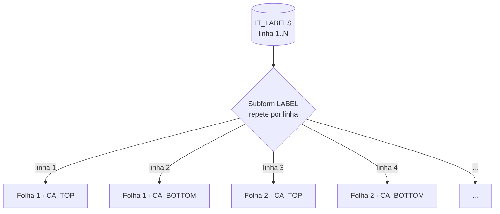

# Adobe Forms - Várias etiquetas na mesma folha


[](https://www.sap.com/index.html)

[](https://github.com/edmilson-nascimento/abap-adobe-forms-labels-per-page)
[](https://github.com/edmilson-nascimento/abap-adobe-forms-labels-per-page/commits/main)

Exemplo de como imprimir **2 (ou N) etiquetas na mesma folha** com SAP Adobe Forms, usando
**uma content area por etiqueta** na master page e **uma única chamada** ao formulário.
Acabam as folhas com metade em branco.

## Resumo rápido

*(o nosso "TL;DR")*

- A folha física tem **duas etiquetas** (cima e baixo), mas cada impressão usava uma folha
  inteira e deixava a etiqueta de baixo sempre vazia.
- O motivo: o programa chamava o formulário **uma vez por etiqueta**. Cada chamada começa
  sempre numa página nova.
- A solução:
  - **ABAP**: monta uma tabela interna com **uma linha por etiqueta** e chama o form **uma vez**.
  - **Form**: a master page tem **duas content areas**, uma sobre cada etiqueta física. O
    subform da etiqueta repete para cada linha e passa sozinho para a área seguinte.
- Para passar a 4 ou 8 por folha, basta acrescentar content areas. O ABAP não muda.



| Etiquetas | Antes (1 chamada por etiqueta) | Depois (1 chamada, 2 content areas) |
|---|---|---|
| 1 | 1 folha (só em cima) | 1 folha (só em cima) |
| 2 | 2 folhas | **1 folha** (cima + baixo) |
| 3 | 3 folhas | **2 folhas** |
| 4 | 4 folhas | **2 folhas** |

## Sumário

- [Necessidade](#necessidade)
- [Como funciona](#como-funciona)
- [Pré-requisitos](#pré-requisitos)
- [O que precisa ser criado (checklist)](#o-que-precisa-ser-criado-checklist)
- [Passo 1 - Dicionário (SE11)](#passo-1---dicionário-se11)
- [Passo 2 - Interface (SFP)](#passo-2---interface-sfp)
- [Passo 3 - Formulário (SFP / LiveCycle Designer)](#passo-3---formulário-sfp--livecycle-designer)
- [Passo 4 - Programa](#passo-4---programa)
- [Passo 5 - Testes](#passo-5---testes)
- [Coisas que costumam confundir](#coisas-que-costumam-confundir)
- [Referências](#referências)

## Necessidade

Folhas com etiquetas pré-cortadas (neste caso A6 com duas etiquetas, uma em cima da outra)
são comuns em impressoras laser de escritório. O layout da etiqueta ocupa menos de metade da
página, mas a implementação típica faz um `LOOP` e chama o function module do formulário uma
vez por etiqueta. O resultado são N folhas para N etiquetas, com metade de cada folha
desperdiçada.

O mesmo acontece quando a quantidade é passada como **cópias** (`SFPOUTPUTPARAMS-COPIES`): a
cópia de spool repete a **página inteira**, e o formulário nunca fica sabendo que existem
várias etiquetas.

## Como funciona

É o equivalente, no Adobe Forms, às várias janelas MAIN na mesma página do SAPscript: o
conteúdo enche a primeira, passa para a segunda e, quando todas estão cheias, abre uma
página nova.



O que faz a etiqueta "pular" para a área seguinte é o **tamanho**: o subform `LABEL` é um
pouco menor do que a content area, então duas nunca cabem na mesma. Como **"Allow page
breaks within content"** está desligado, a etiqueta inteira vai para a próxima content area.

## Pré-requisitos

- Acesso a **SE11** (estrutura e table type), **SFP** (interface e formulário) e **SE38** ou
  ADT (report).
- Adobe LiveCycle Designer instalado (é o editor de layout chamado pela SFP).
- ADS (Adobe Document Services) configurado no sistema, como para qualquer Adobe Form.
- Testado com S/4HANA 2023 on-premise. O report lê a descrição via a CDS released
  `I_ProductDescription`. Em ECC, troque por `MAKT`.

## O que precisa ser criado (checklist)

| # | Objeto | Tipo | Fonte / Definição |
|---|---|---|---|
| 1 | `ZS_LABEL_2UP_DEMO` | Estrutura (SE11) | `MATNR TYPE MATNR`, `MAKTX TYPE MAKTX` |
| 2 | `ZTT_LABEL_2UP_DEMO` | Table type (SE11) | Row type `ZS_LABEL_2UP_DEMO`, standard table |
| 3 | `ZAFI_LABEL_2UP_DEMO` | Interface Adobe (SFP) | Import `IT_LABELS TYPE ZTT_LABEL_2UP_DEMO` |
| 4 | `ZAF_LABEL_2UP_DEMO` | Formulário Adobe (SFP) | Passo 3 |
| 5 | `ZR_LABEL_2UP_DEMO` | Report com classe local | [`files/ZR_LABEL_2UP_DEMO.abap`](files/ZR_LABEL_2UP_DEMO.abap) |

Tudo pode ficar em `$TMP`, já que é um exemplo.

---

## Passo 1 - Dicionário (SE11)

**Estrutura `ZS_LABEL_2UP_DEMO`**

| Componente | Tipo |
|---|---|
| `MATNR` | `MATNR` |
| `MAKTX` | `MAKTX` |

**Table type `ZTT_LABEL_2UP_DEMO`**: row type `ZS_LABEL_2UP_DEMO`, standard table, chave
standard.

## Passo 2 - Interface (SFP)

1. SFP > **Interface** `ZAFI_LABEL_2UP_DEMO` > tipo **ABAP Dictionary-Based Interface**.
2. Em *Form Interface > Import*, crie `IT_LABELS TYPE ZTT_LABEL_2UP_DEMO`.
3. Ative.

> O ponto principal está aqui: a interface recebe uma **tabela**, não uma estrutura. Com
> uma estrutura, a única forma de imprimir N etiquetas é chamar o formulário N vezes, que é
> exatamente o problema.

## Passo 3 - Formulário (SFP / LiveCycle Designer)

### 3.1 Contexto

1. SFP > **Form** `ZAF_LABEL_2UP_DEMO`, com a interface `ZAFI_LABEL_2UP_DEMO`.
2. Arraste `IT_LABELS` da interface para o contexto.
3. Na Data View do Designer aparece `IT_LABELS > DATA > MATNR, MAKTX`.

### 3.2 Master page

1. Tamanho da página: **A6 retrato** (105 × 148 mm), ou seja, o tamanho da **folha**, não de
   uma etiqueta. Se A6 não estiver na lista de *Paper Type*, use *Custom* com 105 × 148 mm.
2. **Apague** a content area padrão.
3. Crie duas content areas, **nesta ordem** na Hierarchy, porque o fluxo enche as áreas pela
   ordem em que aparecem:

| Content area | X | Y | Largura | Altura |
|---|---|---|---|---|
| `CA_TOP` | 2,5 mm | 8 mm | 100 mm | 66 mm |
| `CA_BOTTOM` | 2,5 mm | 8 mm + *pitch* | 100 mm | 66 mm |

*Pitch* é a distância entre o topo da etiqueta de cima e o topo da etiqueta de baixo. Use a
ficha técnica do fornecedor das etiquetas, ou meça com um paquímetro. Os valores acima são
aproximados. Deixe cada content area 1–2 mm maior do que a etiqueta física.

No XML (*View > XML Source*), a master page fica parecida com isto:

```xml
<pageArea name="Page1">
  <medium stock="a6" short="105mm" long="148mm"/>
  <contentArea name="CA_TOP"    x="2.5mm" y="8mm"  w="100mm" h="66mm"/>
  <contentArea name="CA_BOTTOM" x="2.5mm" y="73mm" w="100mm" h="66mm"/>
</pageArea>
```

### 3.3 Body page

1. Subform raiz (da página): **Content = Flowed**.
2. Subform `LABEL` (**Content = Positioned**) com o layout da etiqueta. Neste exemplo:
   - código de barras (Code 128) ligado a `MATNR`;
   - campo de texto ligado a `MATNR` (grande, negrito);
   - campo de texto ligado a `MAKTX`.
3. Configurações do `LABEL`:

| Aba | Propriedade | Valor |
|---|---|---|
| Layout | Tamanho | 1–2 mm **menor** que a content area (ex.: 98 × 64 mm) |
| Binding | Data binding | arraste o nó `DATA` (`$.IT_LABELS.DATA[*]`) |
| Binding | Repeat Subform for Each Data Item | ✅ (Min 1, sem Max) |
| Pagination | Place | *Following Previous* |
| Pagination | After | *Continue Filling Parent* |
| Pagination | Allow Page Breaks within Content | ❌ desligado |

## Passo 4 - Programa

O report está em [`files/ZR_LABEL_2UP_DEMO.abap`](files/ZR_LABEL_2UP_DEMO.abap):

- Seleção por material (`S_MATNR`) com **3 materiais pré-definidos** (troque
  `DEMO-MAT-01..03` em `default_materials( )` por materiais que existam no seu sistema).
- `P_QTY` = etiquetas por material, útil para testar 1, 2 e 3 folhas.
- Classe local `LCL_LABEL_PRINTER`:
  - `GET_LABELS` lê a descrição e transforma a quantidade em **linhas** da tabela;
  - `PRINT` faz **uma única chamada** ao form entre `FP_JOB_OPEN` e `FP_JOB_CLOSE`, com
    `COPIES = 1`.

O trecho que resolve o problema é este:

```abap
" One table row per physical label: quantity becomes data, not copies.
LOOP AT lt_products INTO DATA(ls_product).
  DO mv_qty TIMES.
    APPEND VALUE #( matnr = ls_product-matnr
                    maktx = ls_product-maktx ) TO rt_labels.
  ENDDO.
ENDLOOP.
```

```abap
" ONE call for all labels -> the form paginates 2 per sheet
CALL FUNCTION lv_fm_name
  EXPORTING
    /1bcdwb/docparams = ls_docparams
    it_labels         = it_labels
  ...
```

**Text elements**:
- `TEXT-B01` = `Label selection`
- Selection texts: `S_MATNR` = Material, `P_QTY` = Labels per material, `P_FORM` = Form name

## Passo 5 - Testes

Com os 3 materiais pré-definidos, confira o print preview:

| Materiais | `P_QTY` | Etiquetas | Folhas esperadas | Última folha |
|---|---|---|---|---|
| 3 | 1 | 3 | 2 | só em cima |
| 3 | 2 | 6 | 3 | completa |
| 1 | 1 | 1 | 1 | só em cima |
| 1 | 2 | 2 | 1 | completa, **sem folha em branco depois** |

Depois imprima uma quantidade par e uma ímpar nas folhas de etiquetas reais:

- A bandeja da impressora tem de estar em **A6**, sem "ajustar à página" no driver nem no
  device type.
- Se a etiqueta de baixo sair desalinhada alguns milímetros, ajuste **só o Y da `CA_BOTTOM`**.

## Coisas que costumam confundir

### O tamanho da página é o da folha, não o da etiqueta

A master page tem o tamanho da folha física (A6). Uma etiqueta ocupa só uma parte dela; o
que define onde cada etiqueta cai são as content areas.

### Cópias não resolvem

`COPIES = 3` repete a página inteira três vezes, ou seja, três folhas meio vazias. A
quantidade tem de chegar ao formulário como **linhas da tabela**.

### Folha em branco no final

Se o `LABEL` usar **After: Go to Next Content Area**, ele força uma quebra **também depois
da última etiqueta**. Com quantidade par, essa quebra abre uma folha nova e sai uma **folha
em branco** no fim. Este problema também está descrito no blog da SAP Community linkado
abaixo. Use *Continue Filling Parent* e deixe o tamanho do subform fazer a quebra.

### `hidden` vs `invisible`

Se um dia precisar de deixar um slot vazio (por exemplo, para começar na etiqueta de baixo),
use `presence = "invisible"`. Com `"hidden"` o subform sai do fluxo e a etiqueta seguinte
sobe para o lugar dele.

## Referências

- [Label printing at A4 using Adobe forms - SAP Community (blog)](https://community.sap.com/t5/application-development-and-automation-blog-posts/label-printing-at-a4-using-adobe-forms/ba-p/13517633)
- [Adobe Print Forms - Printing labels - SAP Community (Q&A)](https://community.sap.com/t5/technology-q-a/adobe-print-forms-printing-labels/qaq-p/1675566)
- [LiveCycle Designer - Using master pages](https://help.adobe.com/en_US/livecycle/10.0/DesignerHelp/WS107c29ade9134a2c5f8f98df12a877f47f3-8000.html)
- [LiveCycle Designer - Subform properties in the Pagination tab](https://help.adobe.com/en_US/livecycle/10.0/DesignerHelp/WS92d06802c76abadb-728f46ac129b395660c-7ca7.html)

**Este código é aberto e pode ser alterado sempre que houver ganho didático para o conteúdo.**
